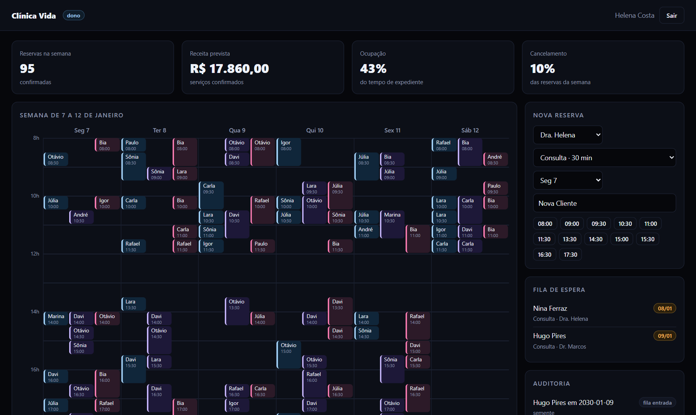
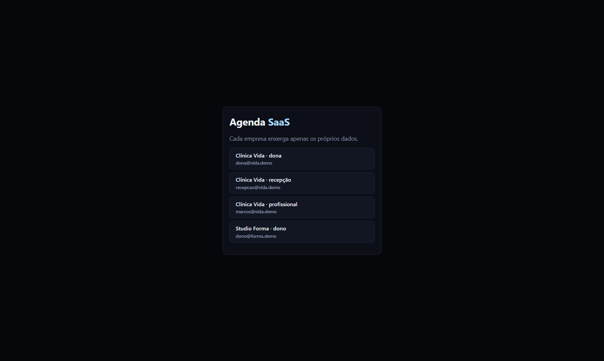
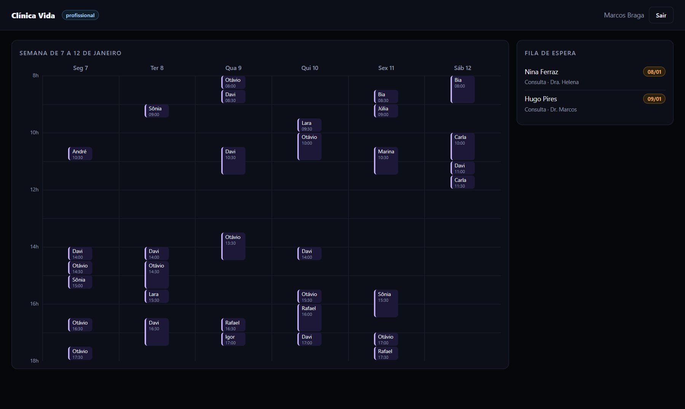
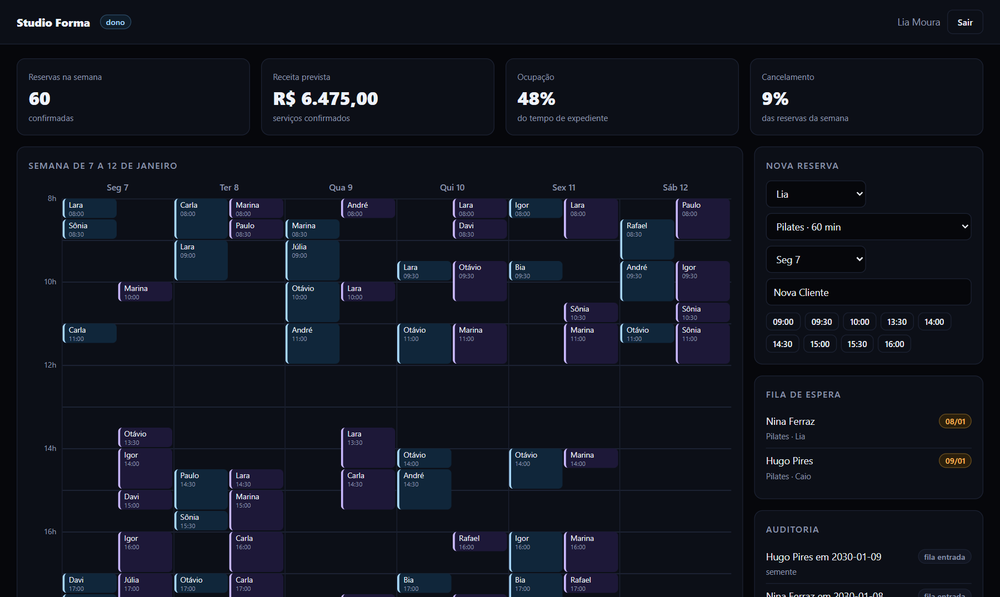
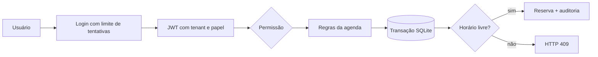
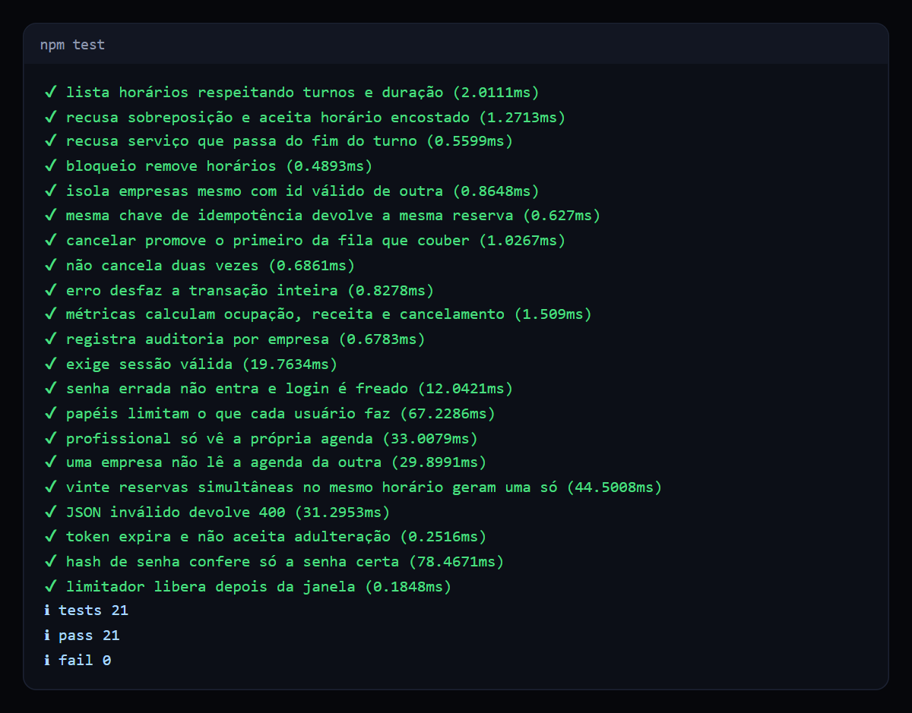

# Agenda SaaS multi-tenant

Plataforma de agendamento para várias empresas no mesmo sistema, com isolamento de dados, papéis de acesso, fila de espera e auditoria.

   

## Veja funcionando



*Painel da dona da clínica: semana completa, ocupação real, receita prevista, fila de espera e auditoria.*

| Entrada por conta | Visão do profissional | Outra empresa |
| --- | --- | --- |
|  |  |  |

## O problema

Um sistema de agenda para um único negócio é simples. Vender o mesmo sistema para centenas de empresas muda tudo: um vazamento entre clientes destrói o produto, dois atendentes podem disputar o mesmo horário, e cada pessoa da equipe precisa ver coisas diferentes.

## O que ele faz

- **Isolamento por empresa:** toda consulta exige o tenant. Um ID válido de outra empresa responde como inexistente.
- **Sem reserva dupla:** a verificação e a gravação acontecem na mesma transação.
- **Papéis:** dono, atendente e profissional têm permissões diferentes, e o profissional só vê a própria agenda.
- **Fila de espera automática:** ao cancelar, o primeiro da fila cujo serviço cabe no horário recebe a vaga.
- **Idempotência:** a mesma `Idempotency-Key` devolve a mesma reserva, sem duplicar em caso de reenvio.
- **Disponibilidade real:** turnos, intervalos, duração do serviço e bloqueios como folgas e congressos.
- **Auditoria e métricas:** quem fez o quê, ocupação, receita e taxa de cancelamento.
- **Autenticação feita à mão:** senha com scrypt, JWT HS256 com expiração e limite de tentativas de login.

## Como funciona



Dois intervalos se sobrepõem quando cada um começa antes do fim do outro. A mesma regra serve para listar horários e validar reservas, então as duas respostas nunca divergem.

O tenant vem do token assinado, nunca de um parâmetro da requisição.

## Decisões técnicas

| Decisão | Motivo |
| --- | --- |
| Tenant em toda assinatura de método | Esquecer o filtro vira erro visível, não vazamento silencioso. |
| Recurso de outra empresa responde 404 | Responder 403 confirmaria que o ID existe. |
| `BEGIN IMMEDIATE` na reserva | Trava a escrita antes de verificar, sem janela para corrida. |
| Fila promovida dentro do cancelamento | A vaga nunca fica livre entre cancelar e promover. |
| Criptografia só com `node:crypto` | Mostra o que uma biblioteca de autenticação faz por baixo. Em produção eu usaria uma biblioteca consolidada. |

## Como rodar

Requer Node.js 24. Não há dependências para instalar.

```bash
npm start     # painel em http://localhost:3000
npm test      # 21 testes
```

A tela de entrada traz quatro contas de demonstração, de duas empresas.

| Método | Rota | Permissão |
| --- | --- | --- |
| `POST` | `/api/login` | pública |
| `GET` | `/api/agenda`, `/api/livres`, `/api/fila` | ver |
| `POST` | `/api/reservas`, `/api/fila` | reservar |
| `DELETE` | `/api/reservas/:id` | cancelar |
| `GET` | `/api/metricas`, `/api/auditoria` | gerir |

## Testes



Um dos testes dispara 20 reservas simultâneas para o mesmo horário pela API e confere que exatamente uma é aceita e 19 recebem `409`.

## Limites conhecidos

- Horários são tratados no fuso local da empresa. Atender vários fusos exigiria guardar UTC e o fuso de cada tenant.
- O limite de login fica em memória, por processo. Com várias instâncias, ele iria para um armazenamento compartilhado.
- SQLite atende a demonstração. Em produção eu usaria PostgreSQL com Row Level Security como segunda barreira de isolamento.

## Estrutura

```text
src/agenda.ts       disponibilidade, reservas, fila, métricas
src/seguranca.ts    senha, token, limite de tentativas e papéis
src/app.ts          rotas HTTP e autorização
src/banco.ts        esquema do banco
src/semente.ts      duas empresas fictícias
public/             painel com calendário semanal
```

## Sobre este projeto

Projeto de demonstração, com dados e empresas fictícios, criado para mostrar a abordagem técnica.

## Autor

**Luiz Renato Carvalho**, Engenheiro de Software e IA · [luizrenato.dev](https://www.luizrenato.dev) · [LinkedIn](https://linkedin.com/in/luizrenatodc)
